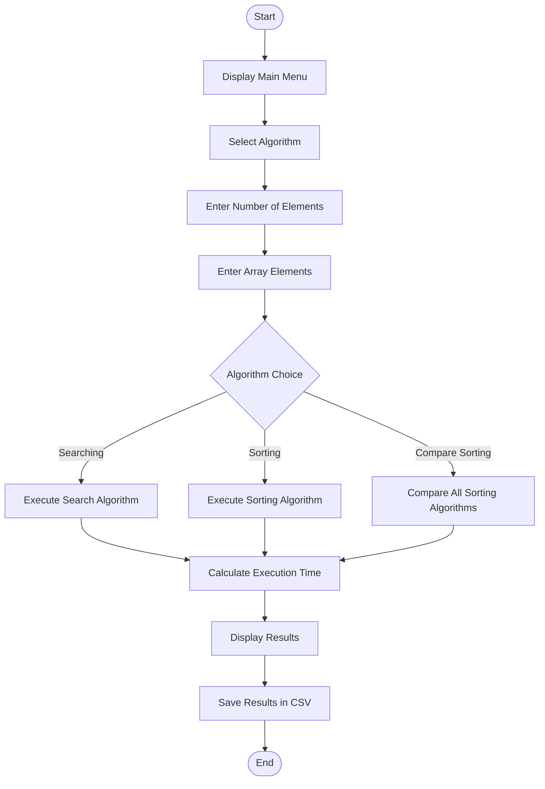

# Algorithm Performance Analyzer

## 1. Problem Statement

Different algorithms solve problems in different ways, and their performance varies depending on the input size.

The **Algorithm Performance Analyzer** is a menu-driven C++ application developed to implement and analyze different sorting and searching algorithms.

The project measures the execution time of algorithms and stores the performance results in a CSV file. It helps understand how different algorithms perform when working with different input sizes.

## 2. Flowchart

## 3. Algorithms Implemented

The project implements the following seven algorithms:

### Sorting Algorithms

1. **Bubble Sort:** Repeatedly compares adjacent elements and swaps them if they are in the wrong order.

2. **Insertion Sort:** Builds a sorted array by inserting each element into its correct position.

3. **Selection Sort:** Finds the smallest element and places it in its correct position.

4. **Merge Sort:** Divides the array into smaller parts, sorts them and merges them.

5. **Quick Sort:** Selects a pivot element and partitions the array around the pivot.

### Searching Algorithms

6. **Linear Search:** Checks each element one by one until the required element is found.

7. **Binary Search:** Searches a sorted array by repeatedly dividing the search interval into two halves.

## 4. Complexity Analysis

The following table shows the time and auxiliary space complexity of the implemented algorithms.

| Algorithm | Best Time | Average Time | Worst Time | Space |
|---|---|---|---|---|
| Bubble Sort | O(n²) | O(n²) | O(n²) | O(1) |
| Insertion Sort | O(n) | O(n²) | O(n²) | O(1) |
| Selection Sort | O(n²) | O(n²) | O(n²) | O(1) |
| Merge Sort | O(n log n) | O(n log n) | O(n log n) | O(n) |
| Quick Sort | O(n log n) | O(n log n) | O(n²) | O(log n) average |
| Linear Search | O(1) | O(n) | O(n) | O(1) |
| Binary Search | O(1) | O(log n) | O(log n) | O(1) |

*Note: The complexity analysis is based on the implemented algorithms. Bubble Sort does not use an early-termination optimization. Quick Sort's auxiliary space can reach O(n) in the worst case due to recursion.*

## 5. Learning Outcomes

Through this project, I learned:

- Implementation of different sorting and searching algorithms using C++.
- Understanding of time and space complexity.
- Measuring algorithm execution time using the C++ Chrono library.
- Comparing algorithm performance for different input sizes.
- Working with file handling in C++.
- Storing performance results in CSV format.
- Understanding the importance of algorithm efficiency and optimization.

## Technologies Used

- **Programming Language:** C++
- **IDE:** Visual Studio Code
- **Data Storage:** CSV file
